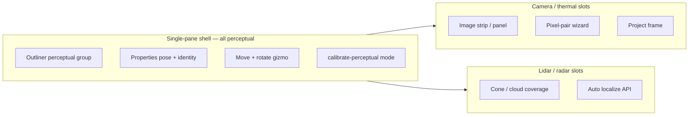

<!--
SPDX-FileCopyrightText: (C) 2026 Intel Corporation
SPDX-License-Identifier: Apache-2.0
-->

# Single-pane UI for perceptual sensors

## Status

UI/UX plan for aligning the Manager **single-pane 3D UI** (this branch) with the
direction of perceptual sensor ingress
([PR #1516](https://github.com/open-edge-platform/scenescape/pull/1516)): cameras,
lidars, radars, and thermal share one pose-centric product surface, while
cameras keep image preview and image-based calibration as first-class extras.

Ingress/schema/ADR details live in that PR; this plan is about how the
[single-pane UI](../../docs/design/single-pane-ui.md) should look and behave.

## Problem today (this branch)

| Surface | Cameras | “Sensors” (singletons) | Gap for lidar/radar |
|---------|---------|------------------------|---------------------|
| Outliner | Cameras group | Sensors group (coverage rings) | No pose-bearing non-camera perceptual type |
| 3D glyph | Frustum + TransformControls (move/rotate) | Ring/disc; move only; Z ignored | Need frustum/cone/cloud + full 6DOF |
| Preview | Camera strip + selected feed panel | None | Image strip is camera-only; not required for all perceptual |
| Project / coverage | “Project frame” onto map mesh | Area footprint only | Coverage overlays without JPEG projection |
| Calibrate | In-viewport dual-view (`calibrate/` wizard + feed) | Side panel area edit (`SensorCalibratePanel`) | Manual = 3D gizmo; Auto = localization API — must not reuse singleton area UI |

Single-pane contracts still apply: one viewport, Outliner + Properties, gizmo
primary / fields precision, calibrate as a **viewport mode** (not a page).

## Direction

**Assume** perceptual ingress: one detection topic, modality metadata, strategy
plugins; singletons stay on `data/sensor/+`.

**UI unifies on capabilities**, not on “everything is a camera”:

| Product family | Outliner | Spatial edit | Calibrate |
|----------------|----------|--------------|-----------|
| Perceptual (camera, thermal, lidar, radar) | One **Perceptual** group (optional modality subgroups) | 6DOF in viewport | Shared calibrate mode; slots by capability |
| Singleton / measurement | Existing **Sensors** group | Coverage area (unchanged) | Existing area panel only |

Do not force lidar/radar through camera frustum + intrinsics chrome, and do not
force them through singleton area calibrate.

## Capability map (drives chrome)

Declare once per modality (mirrors ingress strategy capabilities). Frontend
gates panels and tools from this set — avoid scattered `modality === 'camera'`.

| Capability | Camera / thermal | Lidar / radar | Single-pane surface |
|------------|------------------|---------------|---------------------|
| `pose.edit` | yes | yes | TransformControls move+rotate; Properties pose fields |
| `preview.image` | yes | no | Camera strip overlay + selected preview panel |
| `preview.raw` | no | optional later | Docked raw/cloud panel if/when side channel exists |
| `calibrate.pixel_pairs` | yes | no | Dual-view feed + correspondence (today’s Phase 2.3) |
| `calibrate.pose_gizmo` | yes | yes (primary manual) | Same calibrate shell without media/solve slots |
| `calibrate.auto` | AprilTag / markerless | `/v1/perceptual-sensors/{id}/localization` | Auto action in tool header |
| `visualize.project_frame` | yes | no | Properties “Project frame” + live projective texture |
| `visualize.coverage` | frustum | cone / points | Viewport overlays; header overlay toggles |
| `optics.intrinsics` | yes | no | Properties FOV / intrinsics section |

## Single-pane surfaces

### Outliner and creation

- Add / evolve Outliner so **perceptual** entities are not only “Cameras”.
- Keep **Sensors** = singletons (coverage + scalar MQTT).
- Creation tools: place perceptual sensor with modality from tool header (default
  camera); singleton creation stays the existing sensor tool.
- Selection sync: viewport glyph ↔ Outliner ↔ strip card (when
  `preview.image`) — same single-selection model as
  [single-pane §5](../../docs/design/single-pane-ui.md).

### Properties

- Always: name, identity (`source_key` / status when ingress lands), pose.
- If `optics.intrinsics`: FOV / intrinsics / distortion.
- If `visualize.project_frame`: Project frame + opacity.
- If `visualize.coverage` only: coverage style params (cone angle, cloud
  visibility) — no fake intrinsics.
- Calibrate entry: one “Calibrate…” that opens `calibrate-perceptual` for any
  perceptual; never send lidar/radar to singleton calibrate.

### Preview panels vs 3D projection

Aligned with ingress topic split (fusion vs side channels):

- **Strip / docked panels** = image (or later raw) preview — only when
  `preview.*` is set. Cameras stay first-class here.
- **3D view** = pose glyph + coverage/projection for every perceptual sensor.
  Lidar/radar are first-class in the viewport without a strip card.
- Camera “Project frame” remains the image→map visualize path; other modalities
  use coverage overlays, not projective JPEG texturing.

### Calibrate mode (extend Phase 2.3, don’t fork a product)

Generalize today’s in-viewport camera calibrate
(`manager/frontend/src/viewport/calibrate/`) into a shared shell:

1. **Shell (all perceptual):** select entity → 3D pose preview → dirty
   Save/Cancel → optional Auto → Exit restores single 3D view.
2. **Media slot:** if `preview.image`, keep split feed pane (current dual-view).
   Else 3D-only (manual path = gizmo).
3. **Solve slot:** if `calibrate.pixel_pairs`, keep correspondence + OpenCV
   worker. Else omit.
4. **Auto slot:** capability dispatch (image autocalib vs perceptual
   localization).

Cameras remain special because they fill media + pixel-pair slots; other
modalities share the same mode chrome with those slots empty. Singleton area
calibrate stays a separate flow.

## Implementation sequencing (UI-first on this branch)

1. **Capability module** in `manager/frontend` (static map keyed by modality;
   later wired to API/strategy metadata).
2. **Viewport entities:** pose + glyph builders per modality; gate gizmo axes
   and Properties sections from capabilities.
3. **Outliner / create tools:** perceptual vs singleton naming and place flows.
4. **Calibrate shell refactor:** extract shared session from
   `viewport/calibrate/`; camera plugin = current wizard; non-image = gizmo +
   Auto localize.
5. **Visualize:** keep `useLiveCameraProjection` behind `visualize.project_frame`;
   add coverage overlays for lidar/radar when data/config exists.
6. **Strip:** keep `#ss-cameras-mount` / strip MQTT for `preview.image` only;
   do not require strip membership for perceptual selection in 3D.

Backend/ingress land on their own cadence; UI can soft-gate on `modality`
(default `camera`) until the perceptual model is fully migrated.

## Non-goals

- Specifying MQTT envelope, tracker strategies, or ADR renumbering (ingress PR).
- Merging singleton coverage sensors into perceptual Outliner/calibrate.
- Full raw lidar/radar streaming UX in the first UI pass.
- Leaving the single-pane for Django calibrate pages.

## References

- [Single-pane UI](../../docs/design/single-pane-ui.md) (esp. Phase 2.3 calibrate)
- [Manager UI skill](../skills/manager-ui/SKILL.md) (strip / DOM contracts)
- [PR #1516](https://github.com/open-edge-platform/scenescape/pull/1516) (ingress direction)
- [ADR 13](../../docs/adr/0013-controller-breakdown-microservices.md) (Perception vs measurement Sensor)
